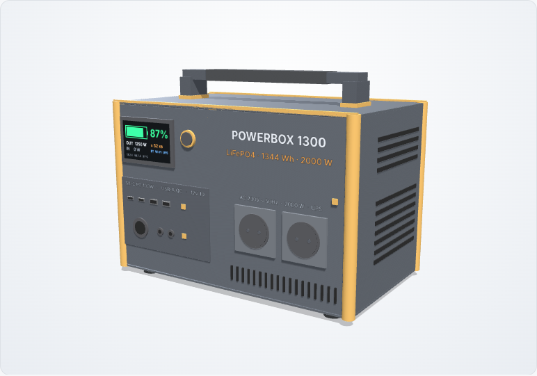
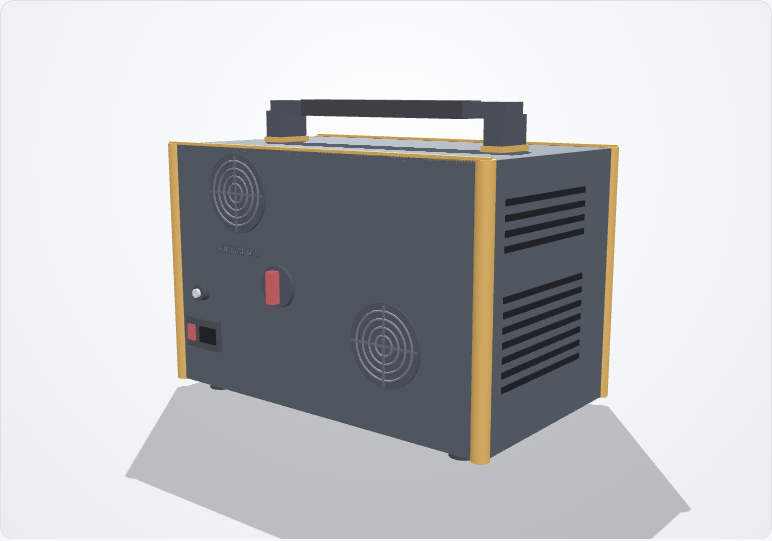
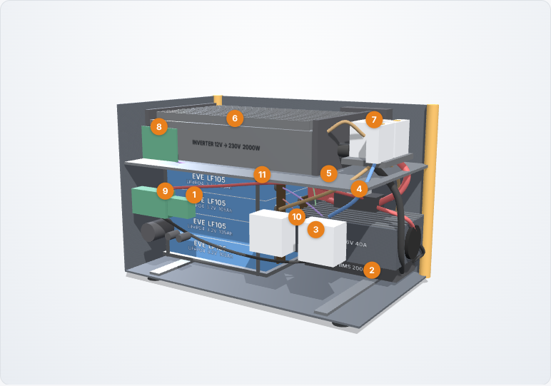
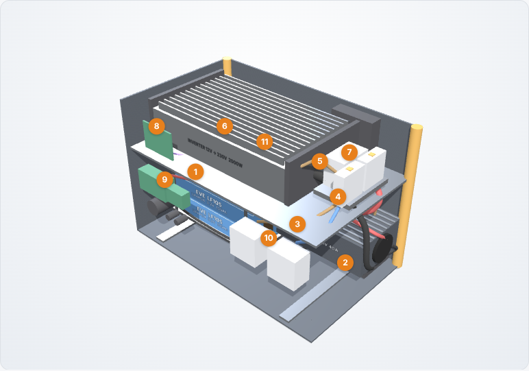
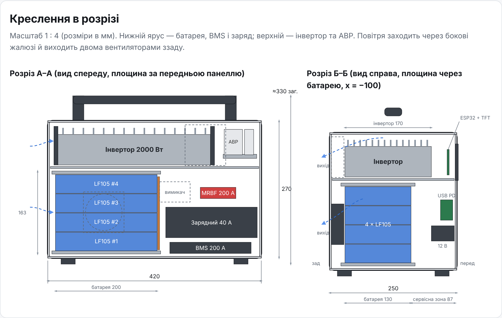
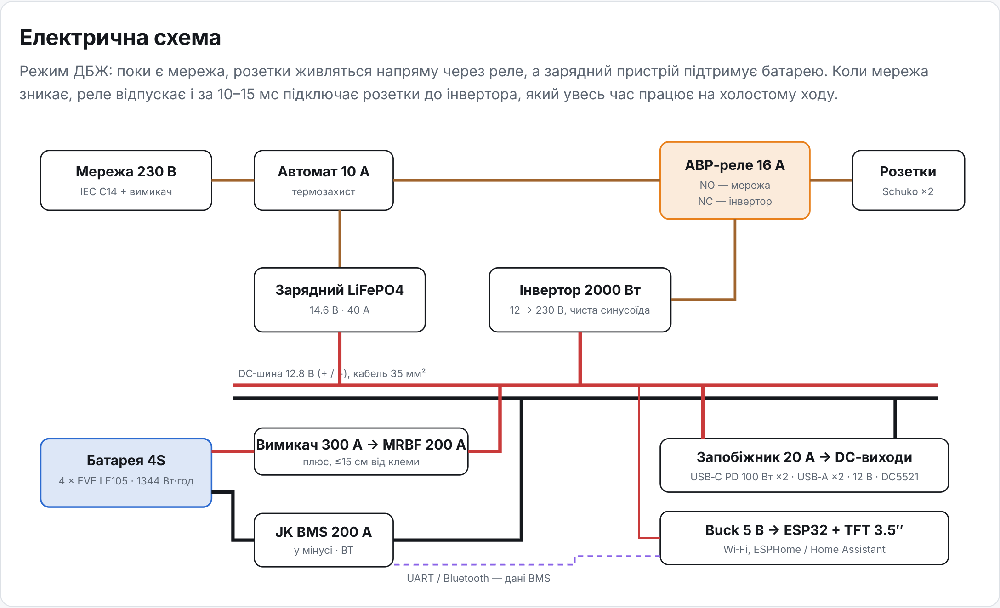

# PowerBox 1300: DIY-зарядна станція

Концепт портативної зарядної станції на LiFePO4. Аналог EcoFlow DELTA 2, Bluetti AC180 та Anker SOLIX C1000, який можна зібрати самостійно.

Відкрийте `index.html` у браузері (або на Netlify). Там інтерактивна 3D-модель з режимами «Корпус», «Розріз» і «Рентген», креслення в розрізі, електрична схема, калькулятор комплектуючих і порівняння з брендами.

| Параметр | Значення |
|---|---|
| Батарея | 4S LiFePO4, 4 × EVE LF105: 12.8 В, 105 А·год, **1344 Вт·год** |
| Вихід 230 В | 2 × Schuko, чиста синусоїда, **2000 Вт** (тривало ≈1.3–1.5 кВт, пік 4000 Вт) |
| Заряд | від мережі 230 В, 40 А: ≈2.5 год |
| ДБЖ | байпас мережі через АВР-реле, перемикання ≈10–15 мс |
| DC | USB-C PD 100 Вт ×2, USB-A QC ×2, прикурювач 12 В, DC5521 ×2 |
| Моніторинг | TFT 3.5″ + Bluetooth (JK BMS) + Wi-Fi (ESP32 / ESPHome / Home Assistant) |
| Габарити / вага | 420 × 250 × 330 мм (з ручкою), ≈15 кг |

## Рендери

| Зовнішній вигляд | Ззаду |
|---|---|
|  |  |
| **Розріз** | **Розріз, вид згори** |
|  |  |




## Варіанти комплектуючих (орієнтовно, листопад 2026)

| | Економ | **Оптимальний** | Преміум (Victron) |
|---|---|---|---|
| Інвертор | 1500 Вт HF | 2000 Вт HF | MultiPlus 12/1600/70 |
| BMS | 150 А BT | JK 200 А BT, активний баланс | JK 200 А |
| Заряд | 20 А, ≈5 год | 40 А, ≈2.5 год | 70 А, ≈1.5 год |
| Вага | ≈14.5 кг | ≈15.5 кг | ≈23 кг |
| **Ціна** | **≈19 600 грн** | **≈28 950 грн** | **≈51 800 грн** |
| Ціна за кВт·год | ≈14.6 тис. | ≈21.5 тис. | ≈38.5 тис. |

Повний перелік позицій із цінами є в `index.html`, у розділі «Комплектуючі та ціни».

## Порівняння з брендами (ціни орієнтовні)

| Модель | Вт·год | Вихід, Вт | кг | ДБЖ | Ціна ≈ |
|---|---|---|---|---|---|
| EcoFlow DELTA 2 | 1024 | 1800 | 12 | 30 мс | 32 000 |
| Bluetti AC180 | 1152 | 1800 | 16 | 20 мс | 30 000 |
| Anker SOLIX C1000 | 1056 | 1800 | 12.9 | <10 мс | 28 000 |
| EcoFlow DELTA 3 Plus | 1024 | 1800 | 12.5 | 10 мс | 38 000 |
| **DIY Економ** | 1344 | 1500 | 14.5 | 10–15 мс | 19 600 |
| **DIY Оптимальний** | 1344 | 2000 | 15.5 | 10–15 мс | 28 950 |

## Головні застереження

- 2 кВт при 12 В означає ≈185 А. Потрібні кабель 35 мм², запобіжник MRBF 200 А і обжим наконечників пресом.
- EVE LF105 тримає 1C (105 А) тривало. Повні 2 кВт доступні кілька хвилин, а тривале навантаження обмежене ~1.3–1.5 кВт. Для тривалих 2 кВт потрібні комірки 230–280 А·год (≈24 кг) або система на 24 В.
- Заряджання нижче 0 °C треба заблокувати в BMS. Комірки збирайте у стяжці.

## Структура

```
index.html        — сторінка проєкту (ТЗ, 3D, креслення, схема, BOM, порівняння)
js/model.js       — 3D-модель компоновки (Three.js)
vendor/           — three.js r128 + OrbitControls (MIT)
renders/          — PNG-рендери
```

Попередня версія репозиторію (UsBudget) лишилася в історії git.
